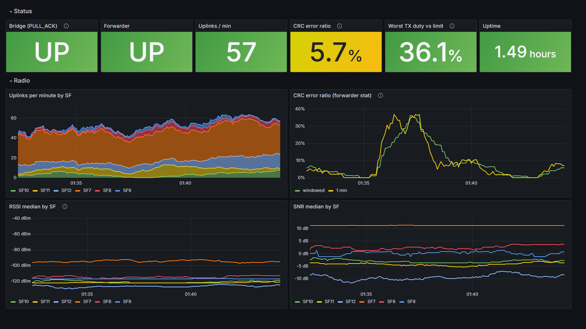
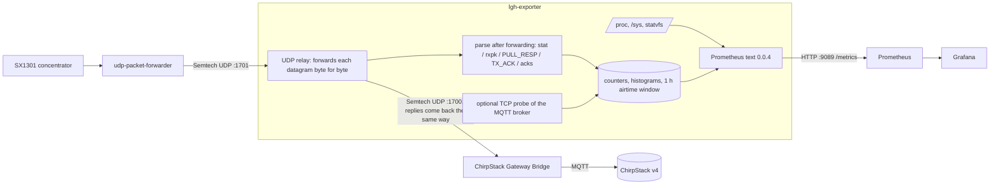

# lorawan-gateway-health

Binary: `lgh-exporter`. Metric prefix: `lgh_`.

A 0.5 MB Rust binary that sits between a LoRaWAN packet forwarder and its bridge on the gateway itself and turns the Semtech UDP traffic into Prometheus metrics: uplinks per channel and spreading factor, CRC-error rate, RSSI/SNR histograms, airtime and EU868 duty-cycle estimates, bridge reachability, and host health.



*Top two rows of the dashboard, a real Grafana screenshot of the demo stack fed by replayed synthetic traffic (see [How the figure was made](#how-the-figure-was-made)). The whole dashboard, including the bridge outage, is in [docs/figure-full.png](docs/figure-full.png).*

This is the gateway-side companion to [lorawan-fleet-doctor](https://github.com/Usernamepersonperson/lorawan-fleet-doctor), which reads network-server uplink events and finds sick devices and silent gateways from the outside. This exporter answers the question that tool cannot: *what does the gateway itself see?* (CRC errors that never reach the network server, downlink rejections, bridge down while the forwarder is fine.)

The target is any embedded-Linux LoRaWAN gateway that runs the Semtech UDP packet forwarder and ships the traffic to a ChirpStack-style gateway bridge on localhost: 32-bit armv7 hard-float SoCs (SAMA5-class Cortex-A5, for example), glibc userland. I have no affiliation with ChirpStack or Semtech, and have not run this on real gateway hardware.

## Target assumptions

| Question | Assumption | Consequence |
|---|---|---|
| CPU | 32-bit armv7 hard-float (NEON/VFPv4), not aarch64 | Rust triple `armv7-unknown-linux-gnueabihf` |
| libc | glibc | Dynamic build is the default; a fully static `armv7-unknown-linux-musleabihf` is also built |
| Packet path | Semtech-style packet forwarder sends to a gateway bridge on `127.0.0.1:1700` (`semtech_udp` backend); the bridge publishes MQTT | Point the forwarder at `127.0.0.1:1701` (the exporter) instead |
| Forwarder settings that matter here | `forward_crc_error: false` (CRC-failed packets are **not** forwarded), `stat_interval: 30`, `keepalive_interval: 10` are typical defaults | CRC errors are only visible in the `stat` block |
| Services | systemd unit in `yocto/` (adapt to OpenRC, runit or a custom process manager) | One process, no dependencies |

Consequence for the design: because the forwarder drops CRC-failed packets, the only place a gateway-side CRC-error rate exists is the periodic `stat` block (`rxnb` received vs `rxok` valid). A UDP tap sees that block; the MQTT side only sees it re-encoded by the bridge.

## Architecture



**Primary path: UDP tap.** The forwarder is pointed at `127.0.0.1:1701` instead of `:1700`; the exporter relays every datagram to the bridge and every reply back, unchanged, and parses a copy afterwards. A parse failure is counted (`lgh_parse_errors_total`) and never touches the data path. Each forwarder source port gets its own upstream socket, so the bridge still sees separate uplink and downlink sockets.

**Optional path (not implemented): ChirpStack MQTT gateway events.** The bridge also emits `stats`, `up`, `ack` events (protobuf or JSON). An MQTT subscriber could build the same families from `GatewayStats`, with the advantage of needing no change to the forwarder config and the drawback of not seeing raw CRC counters, `PULL_ACK` health or `TX_ACK` strings. I chose one path and did it properly; this is a possible follow-up, not a feature.

Port choice: the metrics endpoint defaults to **`127.0.0.1:9089`**. The Prometheus [default port allocations](https://github.com/prometheus/prometheus/wiki/Default-port-allocations) page (read 2026-11-08) lists essentially all of 9100-9999; 9089 is not on it. Change it with `--metrics-listen`. It binds to localhost by default because there is no authentication; use `0.0.0.0:9089` plus a firewall rule or a scraper on the LAN.

## Metrics

All names carry the prefix `lgh_`. `*_total` are counters, `*_bucket/_sum/_count` histograms, the rest gauges.

| Metric | Labels | What it is | Source |
|---|---|---|---|
| `lgh_rx_packets_total` | `channel_mhz sf bw_khz crc` | Uplinks seen on the tap (`crc` = ok / bad / none) | `rxpk` |
| `lgh_rx_rssi_dbm` (histogram) | `channel_mhz sf bw_khz` | RSSI, buckets -135..-50 dBm | `rxpk.rssi` |
| `lgh_rx_snr_db` (histogram) | same | SNR, buckets -20..12.5 dB (LoRa only) | `rxpk.lsnr` |
| `lgh_rx_airtime_seconds_total` | same minus `crc` | Time on air of received uplinks (Semtech formula) | computed from `size/datr/codr` |
| `lgh_forwarder_rx_received_total` / `_crc_ok_total` / `_forwarded_total` | | Sum of `stat.rxnb` / `rxok` / `rxfw` | `stat` |
| `lgh_crc_error_ratio` | | `1 - rxok/rxnb` over the last 10 stat reports | `stat` |
| `lgh_forwarder_downlink_received_total` / `_emitted_total` | | Sum of `stat.dwnb` / `txnb` | `stat` |
| `lgh_forwarder_upstream_ack_ratio` | | `stat.ackr / 100` | `stat` |
| `lgh_tx_requests_total` | | Downlink orders passing the tap | `PULL_RESP` |
| `lgh_tx_ack_total` | `error` | `TX_ACK` results (`NONE`, `TOO_LATE`, `COLLISION_PACKET`, ...) | `TX_ACK` |
| `lgh_tx_airtime_seconds_total` | | Estimated airtime of ordered downlinks | `PULL_RESP.txpk` |
| `lgh_tx_airtime_window_seconds`, `lgh_tx_duty_cycle_ratio` | `band` | Downlink airtime in the last hour and as a fraction of 3600 s, per EU868 sub-band | `PULL_RESP.txpk` |
| `lgh_tx_duty_cycle_limit_ratio` | `band` | The regulatory limit for the band | table in `src/airtime.rs` |
| `lgh_forwarder_up`, `lgh_forwarder_last_seen_timestamp_seconds` | | Forwarder sent PUSH_DATA/PULL_DATA within `--bridge-timeout` | datagrams |
| `lgh_bridge_up` | | Bridge answered a PULL_DATA with PULL_ACK within `--bridge-timeout` | `PULL_ACK` |
| `lgh_bridge_last_ack_timestamp_seconds` | `type` | Last `pull_ack` / `push_ack` | acks |
| `lgh_mqtt_broker_reachable`, `_connect_seconds`, `_last_probe_timestamp_seconds` | | TCP connect to `--mqtt-probe host:port` (TCP only, not MQTT-level) | probe thread |
| `lgh_temperature_celsius` | `sensor` | `/sys/class/thermal/thermal_zone*` and `--temp-file label=path` | sysfs |
| `lgh_cpu_busy_ratio`, `lgh_load1`, `lgh_memory_total_bytes`, `lgh_memory_available_bytes`, `lgh_uptime_seconds` | | Host | `/proc` |
| `lgh_disk_total_bytes`, `lgh_disk_avail_bytes` | `path` | `--disk` (repeatable, default `/`) | `statvfs` |
| `lgh_datagrams_total` | `type` | Datagrams by type | tap |
| `lgh_parse_errors_total`, `lgh_rxpk_parse_errors_total`, `lgh_relay_errors_total` | `kind` | Things that did not parse or relay | tap |
| `lgh_exporter_resident_memory_bytes`, `lgh_exporter_uptime_seconds`, `lgh_exporter_build_info`, `lgh_gateway_info` | | Self metrics, gateway EUI | |

Cardinality is bounded: at most 256 (channel, SF, bandwidth) series, extra ones fold into `channel_mhz="other"`. A scrape with 8 channels and six SFs is about 40 KB.

## Quickstart

### Demo (Docker, one command)

```bash
docker compose up --build
# Grafana    http://localhost:3000   (dashboard "LoRaWAN gateway health"; anonymous viewer, admin/admin to edit)
# Prometheus http://localhost:9090
# Exporter   http://localhost:9089/metrics
```

`lgh-replay forwarder` fakes a packet forwarder (40 devices at fixed link strengths that pick the lowest SF leaving 10 dB of margin, 1 packet/s over 8 EU868 channels, slow fading, a CRC-error burst every 10 minutes, `TX_ACK` replies; the numbers are invented, not a model of any real network). `lgh-replay bridge` acknowledges like a bridge, orders a downlink every 10 s and goes silent for 60 s every 10 minutes so `lgh_bridge_up` drops. `lgh-replay forwarder --file tests/fixtures/traffic.jsonl` replays recorded JSON bodies instead.

### On a gateway

```bash
# 1. get the binary (CI artifact, or build it, see below), copy it to the gateway
scp target/armv7-unknown-linux-gnueabihf/release/lgh-exporter root@gw:/opt/lgh-exporter/

# 2. point the forwarder at the tap: in the forwarder's gateway_local_conf.json
#      "gateway_conf": { "serv_port_up": 1701, "serv_port_down": 1701, ... }
#    (many forwarder packages let a local conf override the global one; check yours)

# 3. run it
/opt/lgh-exporter/lgh-exporter \
    --tap-listen 127.0.0.1:1701 --upstream 127.0.0.1:1700 \
    --metrics-listen 0.0.0.0:9089 --disk / --disk /data
curl -s localhost:9089/metrics | head
```

`yocto/` has a systemd unit and a BitBake recipe for baking it into an image (unverified, see below). Scrape config: `demo/prometheus.yml`. Dashboard: `grafana/dashboards/lgh-gateway-health.json` (generated by `scripts/gen_dashboard.py`; import it into any Grafana 10/11 with a Prometheus datasource named `Prometheus`, uid `prometheus`).

Flags: `--tap-listen`, `--upstream`, `--metrics-listen`, `--region eu868|none`, `--bridge-timeout`, `--mqtt-probe host:port`, `--mqtt-probe-interval`, `--disk`, `--temp-file label=path`. `--help` lists the defaults.

### Build and test

```bash
cargo test                      # 78 tests: unit + exposition validity + loopback UDP relay + HTTP
cargo clippy --all-targets -- -D warnings
# cross-build for armv7 hard-float gateways:
sudo apt install gcc-arm-linux-gnueabihf
rustup target add armv7-unknown-linux-gnueabihf armv7-unknown-linux-musleabihf
cargo build --release --target armv7-unknown-linux-gnueabihf     # glibc
cargo build --release --target armv7-unknown-linux-musleabihf   # fully static
```

Release profile: `opt-level = "z"`, LTO, `panic = "abort"`, stripped. Dependencies: `serde`, `serde_json`, `libc`. No async runtime; an HTTP thread per scrape, one relay thread plus one reader thread per forwarder socket.

## Measurements

Binary sizes (stripped release builds). Authoritative numbers are from CI (run 42517093586, 2026-11-08: `ubuntu-latest`, Rust stable, `gcc-arm-linux-gnueabihf`); the artifacts are on each run page.

| Target | `lgh-exporter` | `lgh-replay` |
|---|---:|---:|
| `armv7-unknown-linux-gnueabihf` (glibc) | 527,540 B (515 KiB) | 461,996 B |
| `armv7-unknown-linux-musleabihf` (static) | 592,684 B (579 KiB) | 527,140 B |
| `x86_64-unknown-linux-musl` (static, used in the Docker demo) | 647,968 B (633 KiB) | 590,624 B |

Local Docker cross-builds gave the same armv7 sizes (527,588 B glibc, 592,684 B musl). An earlier CI run on an older runner image and toolchain measured 498,876 B / 547,628 B, so these sizes move with the toolchain version.

Memory, measured with `scripts/measure.sh` (exporter + replay bridge + replay forwarder on loopback, 20 s of traffic, two scrapes):

| Run | Exporter VmRSS | Scrape |
|---|---:|---|
| x86_64 musl in Alpine (local Docker), 4 packets/s | 564 kB | 43,429 B, 508 samples |
| x86_64 musl in Alpine (local Docker), 10 packets/s | 544 kB | 40,959 B, 476 samples |
| x86_64 musl on the CI runner, 4 packets/s | 648 kB | |
| armv7 musl in an `arm/v7` Alpine container, **under qemu-user** (local) | 8.3 MB | 38,344 B, 444 samples |
| armv7 musl / glibc on the CI runner, **under qemu-user** | 8.7 MB / 10.6 MB | |

The ARM rows prove the armv7 binaries start, relay, acknowledge and serve metrics end to end (local run: 90 PUSH_DATA all acked, 7 downlinks each with a TX_ACK); CI repeats the smoke run for both armv7 targets. The 8-10 MB is the emulator's footprint, not the exporter's: do not read it as an ARM number. I have no real ARM RSS and no CPU-load figure for a Cortex-A5.

## How the figure was made

`docs/figure.png` is a real screenshot, not a mock-up: the Grafana 11.2.0 container from `docker-compose.yml`, captured with headless Edge by `scripts/screenshot_dashboard.py` after about 13 minutes of `lgh-replay` traffic (1 packet/s, 40 invented devices), cropped to the top two rows and padded to 1600x900. The CRC-error hump is the replay's scheduled burst; the 60 s bridge outage and recovery are in `docs/figure-full.png` (Backhaul row). The data is synthetic, not from a gateway. The Temperature panel is empty in the demo because the container has no thermal sensors; I did not invent a value.

## Tests

78 tests, `cargo test`:

- `src/semtech.rs`: header checks, `stat`-only and `rxpk` PUSH_DATA, FSK, missing fields, one bad `rxpk` among good ones, truncated/garbage JSON, `PULL_RESP`/`txpk` defaults, `TX_ACK` with and without JSON.
- `src/airtime.rs`: time on air against the TTN airtime calculator values for SF7-SF12 (125 kHz, 10 B application payload = 23 B on air: 61.7, 113.2, 205.8, 370.7, 823.3, 1482.8 ms; the same six numbers lorawan-fleet-doctor asserts), 64 B frames at SF7 and SF12 (118.016 ms, 2.7935 s), low-data-rate optimisation, downlink without CRC, FSK, EU868 sub-band lookup.
- `src/metrics.rs`: counter math across stat reports, windowed CRC ratio, cumulative histogram buckets, the 1 h duty window (and that the lifetime counter outlives it), series cap, bridge-up logic, error counting.
- `tests/exposition.rs`: every line is a valid comment or sample, `HELP`/`TYPE` once per family and contiguous, counters end in `_total`, histogram buckets cumulative with `+Inf == _count`, label escaping round trip.
- `tests/relay.rs`: real UDP and TCP on loopback: datagrams pass byte for byte in both directions, two forwarder sockets get two bridge-side sockets, garbage is relayed and counted, a forwarder that restarts on many new source ports is never locked out (least-recently-used sessions are evicted), HTTP routes.

CI (`.github/workflows/ci.yml`): fmt, clippy `-D warnings`, tests, generated files not stale; cross-builds for the three targets above with sizes in the job summary and the binaries as artifacts; ARM binaries get a smoke run under qemu; a job brings up the compose stack and checks Prometheus and Grafana.

## What is not verified yet

- **Never run on real gateway hardware** or any real concentrator. All traffic is synthetic (`lgh-replay`) or hand-written fixtures built from the field list in Semtech's `PROTOCOL.TXT` (v1.4, read 2026-11-08). No real capture was used.
- **Vendor forwarders may deviate from the reference protocol.** Some gateway firmwares ship closed-source forwarders I could not read. If one adds fields or changes `stat` semantics, counters may be off. `stat` values are assumed per-interval, as in the reference forwarder.
- **The Yocto recipe was never built.** `yocto/meta-lorawan-gateway-health` is written against common Yocto Rust recipe conventions; `CARGO_TARGET_SUBDIR`, the crate list format and the layer wiring are untested. The crate list is generated from `Cargo.lock` by `scripts/gen_yocto_crates.py` (CI checks it is current). `SRCREV` is `AUTOREV`.
- **The systemd unit is untested** on a real image, as is the claim that your forwarder's local config overrides its global one.
- **No concentrator temperature.** The packet-forwarder protocol does not carry it. The exporter reads kernel thermal zones and any `--temp-file` you give it; I do not know what a given gateway exposes in sysfs.
- **`lgh_bridge_up` means "the bridge process answers PULL_DATA"**, not "MQTT is connected". The MQTT probe is a TCP connect to the broker you name, not an MQTT handshake and not the bridge's own session. The bridge's real MQTT state is invisible on this path.
- **Duty cycle is an estimate**: airtime of downlinks *ordered* (a `TOO_LATE` or `COLLISION_PACKET` order is still counted, so it errs high), per EU868 sub-band from my reading of the LoRaWAN regional parameters. I did not re-check the band edges and limits against ETSI EN 300 220 or the LoRaWAN Regional Parameters text. Other regions: `--region none` gives one unlimited band.
- **Airtime formula** is the Semtech SX1276 one; I checked it against the TTN calculator numbers as quoted in lorawan-fleet-doctor, not against a live run of the calculator.
- **Histogram medians** in the dashboard are interpolated inside buckets (5-10 dB wide). RSSI is the protocol's channel `rssi`, not the post-correlation signal RSSI some concentrators add.
- **ARM memory and CPU**: no real figure (see Measurements). The glibc armv7 binary was cross-built and is smoke-tested only in CI under qemu, not locally.
- One gateway per exporter; the gateway EUI is exposed as an info metric, not a label on every series.
- Only the primary (UDP tap) path exists. The ChirpStack v4 MQTT event path is documented, not built. `chirpstack-udp-forwarder` speaks the same UDP protocol, so the tap should work there; untested.
- No authentication on `/metrics`; binds to localhost by default.

## Layout

```
src/semtech.rs     Semtech UDP protocol parser
src/airtime.rs     LoRa time on air, EU868 sub-bands
src/metrics.rs     state + Prometheus text rendering
src/relay.rs       transparent UDP relay      src/http.rs   /metrics server
src/sys.rs         /proc, /sys, statvfs       src/cli.rs    flags
src/bin/replay.rs  synthetic forwarder and bridge for the demo
tests/             fixtures, exposition, loopback relay
grafana/           provisioning + dashboard JSON     demo/   Prometheus config
yocto/meta-lorawan-gateway-health/   BitBake layer (unverified)
scripts/           dashboard + crate-list generators, measure.sh
```

MIT licensed.
